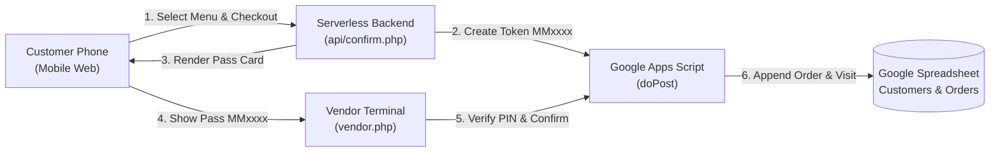

# Mama Momo - Momo Stall Loyalty Web Application

## 1. System Overview & Architecture

Mama Momo is a lightweight, mobile-first web application and automated loyalty tracker designed specifically for high-velocity street food stalls. The platform enables customers to place momo orders quickly on their phones and receive a 6-character order pass token. Stall attendants verify the order pass using a secured vendor terminal, which writes finalized orders to Google Sheets and automatically rewards customers with **Flat 50% Off on their 5th visit**.



### Technology Stack
* **Frontend:** Mobile-responsive HTML5, CSS3, and vanilla JavaScript (no heavy JavaScript frameworks for instant mobile loading).
* **Backend:** PHP running on Vercel Serverless Functions using runtime `vercel-php@0.7.3`, with backward-compatible Apache `.htaccess` for local WAMP/XAMPP environments.
* **Database & Ledger:** Google Sheets interfacing via Google Apps Script Web App (`doGet` and `doPost`).

---

## 2. Directory Layout & Routing Architecture

The codebase strictly isolates customer-facing API routes while masking internal directories through rewrite engines:

```text
mama-momo/
├── .htaccess             # Apache mod_rewrite & DirectoryIndex for WAMP/local servers
├── vercel.json           # Vercel Serverless runtime & clean route masking
├── vendor.php            # Stall attendant verification terminal
├── Code.gs               # Google Apps Script database controller
├── PROJECT.md            # System specifications, architecture & test suite
└── api/
    ├── index.php         # Screen 1: Mobile-first hero landing card
    ├── menu.php          # Screen 2: Interactive menu catalog & dynamic cart
    ├── checkout.php      # Screen 3: Customer details review & checkout
    └── confirm.php       # Screen 4: Serverless token generator & order pass (PRG)
```

### Clean URL Routing Rules
Both `vercel.json` and `.htaccess` mask the internal `/api` directory:

| Public Endpoint | Target Handler | Description |
| :--- | :--- | :--- |
| `^/$` | `/api/index.php` | Mobile-first landing card & promotion banner |
| `^/menu/?$` | `/api/menu.php` | Item catalog, +/- quantity controls & live cart bar |
| `^/checkout/?$` | `/api/checkout.php` | Itemized review, name & 10-digit mobile validation |
| `^/confirm/?$` | `/api/confirm.php` | Token pass generator & Post-Redirect-Get handler |
| `^/vendor/?$` | `/vendor.php` | Attendant order verification terminal |

---

## 3. Database Schema & Google Apps Script (`Code.gs`)

The database consists of a single Google Spreadsheet with three synchronized tabs:

### 1. `Customers` Tab (A:D)
| Column | Header | Data Type | Purpose |
| :---: | :--- | :--- | :--- |
| **A** | `Phone` | String (10 digits) | Primary customer identifier |
| **B** | `Name` | String | Customer display name |
| **C** | `VisitCount` | Integer | Total verified visits completed |
| **D** | `LastVisit` | DateTime | Timestamp of the last counted visit (used for 12h cooldown) |

### 2. `Orders` Tab (A:I)
| Column | Header | Data Type | Purpose |
| :---: | :--- | :--- | :--- |
| **A** | `Timestamp` | DateTime | Order timestamp |
| **B** | `OrderID` | String (6 chars) | Unique 6-character token (e.g. `MM4219`) |
| **C** | `Phone` | String | Customer mobile number |
| **D** | `Name` | String | Customer name |
| **E** | `Items` | String | Summary string (e.g. `2 × Classic Veg Momo`) |
| **F** | `TotalAmount` | Number (₹) | Final payable amount (stored after discount or standard pricing) |
| **G** | `VisitNumber` | Integer | Visit stamp sequence number |
| **H** | `DiscountApplied` | String (`YES`/`NO`) | Whether 50% 5th-visit discount was applied |
| **I** | `Status` | String | `PENDING`, `APPROVED`, or `APPROVED_COOLDOWN` |

### 3. `Menu` Tab (A:G) - Dynamic Menu Catalog & Draft Management
| Column | Header | Data Type | Purpose |
| :---: | :--- | :--- | :--- |
| **A** | `ID` | String/Number | Unique item identifier (e.g. `1`, `2`, `MM01`) |
| **B** | `Name` | String | Item display name (e.g. `Classic Steamed Veg Momo`) |
| **C** | `Price` | Number (₹) | Base price in Indian Rupees (e.g. `80`) |
| **D** | `Description` | String | Ingredients, seasoning, and preparation note |
| **E** | `Category` | String | Dish category for filtering (e.g. `Steamed Veg`, `Specialties`) |
| **F** | `Available` | String (`YES`/`NO`) | Stock switch (`YES` = In Stock, `NO` = Sold Out) |
| **G** | `View on Menu` | String (`YES`/`NO`) | Visibility / Draft switch (`YES` = Live, `NO` = Draft / Hidden) |

---

### 3. Glossary of Terms & Data Fields Used in Google Sheets

Below is the definitive reference for all tabs, column headers, status flags, and data attributes stored and managed in the Google Sheet:

#### A. Tab-Level Terms
| Term | Meaning & Purpose |
| :--- | :--- |
| **`Customers`** | The customer master directory and loyalty stamp tracker. Each row represents a unique customer profile identified by their 10-digit mobile number, tracking their cumulative visit history and last visit timestamp. |
| **`Orders`** | The immutable transaction ledger. Each row represents an individual momo order placed by a customer and verified by stall staff, tracking items, pricing, discounts, and authorization status. |

#### B. `Customers` Tab Column Headers
| Header | Column | Meaning & Detailed Description |
| :--- | :---: | :--- |
| **`Phone`** | **A** | **Primary Customer Identifier (Key)**: The normalized 10-digit mobile number of the customer (e.g., `9822334455`). Used to look up previous visit history, determine cooldown status, and calculate eligibility for loyalty discounts. |
| **`Name`** | **B** | **Customer Full Name**: The name provided by the customer at checkout (e.g., `Vikram Roy`). Used for customer identification on order passes and vendor terminals. |
| **`VisitCount`** | **C** | **Total Counted Loyalty Visits**: An integer counter representing the number of valid visits completed by the customer that earned a loyalty stamp. Increments by +1 upon each approved visit outside the 12-hour cooldown window. Every 5th visit (5, 10, 15...) unlocks 50% off. |
| **`LastVisit`** | **D** | **Last Visit Timestamp**: The exact date and time when the customer's last loyalty-qualifying visit was approved. Serves as the reference point for the 12-hour cooldown calculation ($\Delta t = \text{currentTime} - \text{LastVisit}$). |

#### C. `Orders` Tab Column Headers
| Header | Column | Meaning & Detailed Description |
| :--- | :---: | :--- |
| **`Timestamp`** | **A** | **Order Processing Timestamp**: The system date and time when the order row was created or finalized in Google Sheets (e.g., `11/5/2026 22:39:15`). |
| **`OrderID`** | **B** | **6-Character Order Pass Token**: A unique alphanumeric token starting with `MM` followed by 4 random digits (e.g., `MM4219`, `MM5746`). Displayed on the customer's mobile order pass and entered by the stall vendor for instant verification. |
| **`Phone`** | **C** | **Customer Mobile Number**: The 10-digit mobile phone number associated with the transaction, linking the order to the customer's profile in the `Customers` tab. |
| **`Name`** | **D** | **Customer Name**: The customer's display name as captured during the order submission. |
| **`Items`** | **E** | **Itemized Momo Selection**: A readable, comma-separated string listing the exact momo items and quantities ordered (e.g., `2 × Steamed Chicken Momo, 1 × Crispy Fried Veg Momo`). |
| **`TotalAmount`** | **F** | **Final Payable Amount (₹)**: The total monetary value collected at the stall counter for this order. Represents the discounted price (50% off) if the 5th-visit reward was unlocked, or regular menu pricing otherwise. |
| **`VisitNumber`** | **G** | **Sequential Visit Index**: An integer indicating the sequence number of this visit for the customer (e.g., `1` for 1st visit, `5` for 5th reward visit). |
| **`DiscountApplied`** | **H** | **50% Loyalty Reward Indicator**: Indicates whether the 50% 5th-visit loyalty discount was applied to this transaction (`YES` / `YES (50% OFF)` or `NO`). |
| **`Status`** | **I** | **Transaction Lifecycle State**: Reflects the operational verification and approval outcome of the order (see status values below). |

#### D. Order Status Values (`Status` Column)
| Status Value | Meaning & Operational Context |
| :--- | :--- |
| **`PENDING`** | The initial temporary state recorded when a customer generates an order token on their phone. Indicates the order pass has been issued, but the customer has not yet paid or been verified by stall staff. |
| **`APPROVED`** (or `APPROVED_COUNTED`) | The transaction was fully verified by the stall attendant with a valid Vendor PIN (`1234`). Payment was collected, the order was fulfilled, and the customer **earned +1 loyalty stamp** added to their `VisitCount`. |
| **`APPROVED_COOLDOWN`** | The transaction was verified and payment collected, but because the order occurred within 12 hours of the customer's previous visit, **no additional loyalty stamp was granted**. This protects the stall against artificial stamp accumulation from multiple orders on the same day. |

#### E. Business & Logic Terms Used in Backend Calculations
| Term | Meaning & Calculation |
| :--- | :--- |
| **`12-Hour Cooldown` (`isCooldown`)** | Security rule triggered when $\text{currentTime} - \text{LastVisit} < 12\text{ hours}$. Prevents repeat stamp collection on the same day while still allowing order placement. |
| **`Projected Visit` (`projectedVisit`)** | Anticipated visit count for the current order: $\text{currentVisit} + 1$ (if outside cooldown). Evaluated to check if $\text{projectedVisit} \pmod 5 = 0$. |
| **`Remaining Visits` (`remainingVisits`)** | The number of visits left until the next 50% discount: $5 - (\text{projectedVisit} \pmod 5)$. Displayed on the customer's order pass card. |
| **`Vendor PIN`** | A 4-digit master passkey (default: `1234`, configurable via Google Apps Script Script Properties) required to authorize and finalize order writes into Google Sheets. |
| **`Script Lock` (`LockService`)** | A Google Apps Script concurrency mechanism with a 15-second timeout (`lock.tryLock(15000)`) ensuring thread-safe serial writes to the spreadsheet during peak customer rushes. |

---

## 4. Loyalty Rules & Core Business Logic

### 1. 5th-Visit 50% Loyalty Discount
* On every visit, if not in cooldown:
  $$\text{projectedVisit} = \text{currentVisit} + 1$$
* When $\text{projectedVisit} \pmod 5 = 0$, the system triggers `isDiscount = true`.
* **Discount Value:** Flat 50% off the order subtotal:
  $$\text{finalPrice} = \text{round}\left(\text{subtotal} \times 0.5\right)$$
* The customer pass renders a high-contrast green banner: `🎉 5th VISIT: 50% OFF UNLOCKED!` with the original price struck through (`<s>₹240</s> ₹120`).

### 2. 12-Hour Cooldown Protection
* To prevent duplicate stamp collection on multiple orders placed on the same day:
  $$\Delta t = \text{currentTime} - \text{lastVisit}$$
* If $\Delta t < 12\text{ hours}$:
  * `isCooldown = true`
  * Order is logged with status `APPROVED_COOLDOWN`.
  * `VisitCount` is **not** incremented.
  * Loyalty discount is bypassed until 12 hours have elapsed.

### 3. Concurrency Lock
* To prevent race conditions during peak stall rushes, all write operations execute under a 15-second script lock:
  ```javascript
  const lock = LockService.getScriptLock();
  if (!lock.tryLock(15000)) { ... }
  ```

---

## 5. End-to-End User Flow & Screens

### Screen 1: Landing Page (`api/index.php`)
* **Hero Card:** Clean Himalayan theme branding with emoji logo 🥟.
* **Header:** `"The Momo Point / Mama Momo"`.
* **Promo Banner:** `"🎁 5th Visit = Flat 50% Off Your Order"`.
* **CTA Button:** `"View Menu & Order"` routing cleanly to `/menu`.

### Screen 2: Interactive Menu (`api/menu.php`)
* **Item Catalog:**
  1. Classic Steamed Veg Momo — ₹80
  2. Steamed Chicken Momo — ₹120
  3. Crispy Fried Veg Momo — ₹100
  4. Crispy Fried Chicken Momo — ₹140
  5. Jhol Momo Soup Bowl — ₹130
* **Cart Features:** Increment/decrement controls (`−`/`+`) with local state persistence (`mama_cart` in `localStorage`), empty-cart validation, and a sticky bottom cart bar displaying total price and `"Proceed to Checkout"`.

### Screen 3: Checkout Page (`api/checkout.php`)
* Displays an itemized breakdown and subtotal.
* Inputs: Customer Name (`required`, max 80 chars) and 10-Digit Mobile (`[0-9]{10}`, `required`).
* Clears `localStorage` cart upon submission to prevent double submission.
* Dispatches form POST to `/confirm`.

### Screen 4: Confirmation, Live Polling & Thank You Screen (`api/confirm.php`)
* **Post-Redirect-Get (PRG) Pattern:** POST processes `createOrder` via cURL to Google Apps Script, saves order state into session, and redirects (HTTP 303) to GET `/confirm`.
* **Refresh Proof:** Reloading the browser maintains the exact same order token and details without triggering form resubmission or creating duplicate orders.
* **Pass Display:** Prominent 6-character token (e.g. `MM4922`), customer details, discount ribbon, and counter instruction:
  > *"📢 Show this screen to the counter staff to verify."*
* **Live Vendor Confirmation & Collection Screen:** While the customer waits, the screen listens for vendor confirmation (via fast local polling and Google Apps Script). As soon as the vendor approves the order:
  - An audio celebration chime and haptic feedback play.
  - The card smoothly transitions to the **"Thank You & Collect Order"** screen.
  - Prominent banner instructs: *"🔔 ORDER CONFIRMED - Please collect your freshly prepared momos at the counter!"*
  - Shows verified payment, token chip, updated loyalty stamps, and a *"Place Another Order"* button.

### Screen 5: Vendor Verification Terminal (`vendor.php` / `api/vendor.php`)
* Designed for the stall attendant's phone and tablet.
* **Pixel-Perfect Search Bar:** Clean, aligned layout with `width: 0; flex: 1 1 auto; min-width: 0;` ensuring the `🔍 Check Order` button stays perfectly within the container borders with zero overflow.
* **Customer Details Modal Popup:** Attendant enters the 6-character token and clicks **"🔍 Check Order"**. A dark-themed popup modal appears displaying:
  * Customer Name with avatar
  * Customer Mobile Number
  * Itemized Momo Selection
  * Total Payable Amount
  * Real-time Loyalty Stamp pill (or 50% discount ribbon)
  * Vendor PIN input (default: `1234`)
* **One-Click Confirmation:** Attendant clicks **"✅ Confirm & Save to Sheet"** inside the modal, which submits the full bundle (`orderId`, `phone`, `name`, `items`, `totalAmount`, `pin`) to Google Apps Script.
* **Latest 5 Orders Feed:** Automatically loads and displays the 5 most recent orders on the stall terminal with token, customer, amount, visit stamp, and time.
* **PIN-Protected All Orders History Dashboard:**
  * Access requires entering the 4-digit Vendor PIN (`1234`).
  * **Default View of Today:** Automatically defaults to today's date and today's orders upon opening.
  * **Date Filtering:** Quick pills (`🟢 Today`, `Yesterday`, `Last 7 Days`, `All Time`) plus a custom date picker.
  * **Live Search:** Instant client-side search by token, customer name, mobile number, or item names.
  * **Summary Metrics:** Dynamic real-time calculation of Total Orders, Total Revenue (₹), and Discounts Applied for the filtered view.

---

## 6. Comprehensive Test Suite & Execution Results

| Test ID | Category | Scenario / Action | Expected Result | Execution Status |
| :---: | :--- | :--- | :--- | :---: |
| **TC-01** | Routing | Navigate to `/` | Loads landing card with title "The Momo Point / Mama Momo" | **PASS** |
| **TC-02** | Menu | Navigate to `/menu` | Lists 5 catalog items with correct pricing (Veg ₹80, Chicken ₹120, etc.) | **PASS** |
| **TC-03** | Cart | Increment item counts (2× Veg ₹160 + 1× Chicken ₹120) | Bottom sticky bar dynamically updates to ₹280 | **PASS** |
| **TC-04** | Cart Validation | Click checkout with 0 items | Alert shown; navigation blocked until items added | **PASS** |
| **TC-05** | Checkout | Submit checkout with valid name and `[0-9]{10}` phone | Serializes cart and posts cleanly to `/confirm` | **PASS** |
| **TC-06** | Pass Generation | Order pass rendered on `/confirm` | Generates 6-character token (`MMxxxx`), displays payable amount | **PASS** |
| **TC-07** | PRG Reload | Refresh `/confirm` in browser (`F5` / reload) | Retains exact same token and pass details; no resubmission popup | **PASS** |
| **TC-08** | Multi-User | User 1 (`Aarav Sharma`) and User 2 (`Priya Nair`) order consecutively | Generates distinct tokens (`MMxxxx` $\ne$ `MMyyyy`) without cart cross-bleed | **PASS** |
| **TC-09** | Vendor Verification | Attendant confirms token with PIN `1234` | Backend validates PIN, logs row to Google Sheets `Orders`, updates `Customers` | **PASS** |
| **TC-10** | Vendor Token Management | Attendant leaves phone/name blank on `/vendor` | System resolves customer data from token automatically | **PASS** |
| **TC-11** | Vendor Reload | Attendant refreshes `/vendor` page | Last confirmed receipt remains displayed from local storage | **PASS** |
| **TC-12** | Cooldown Enforcement | Repeat order confirmed for same phone within 12h | Status logged as `APPROVED_COOLDOWN`; stamp not incremented | **PASS** |
| **TC-13** | Modal Popup | Check order token on `/vendor` | Customer Details modal popup appears with itemized breakdown & total | **PASS** |
| **TC-14** | Search Button Layout | Inspect `.token-input-group` on `/vendor` | `🔍 Check Order` button has 0px overflow and aligns inside box boundary | **PASS** |
| **TC-15** | Latest 5 Orders | Load `/vendor` feed | Displays up to 5 latest orders dynamically with token, name, amount, and stamp | **PASS** |
| **TC-16** | PIN-Protected History | Click "📜 All Orders" without PIN | Modal `#pinLockModal` prevents access until valid PIN `1234` is verified | **PASS** |
| **TC-17** | Today Default View | Open unlocked All Orders dashboard | Defaults to `🟢 Today` filter with today's date, metrics, and orders | **PASS** |
| **TC-18** | History Date Filtering | Click `All Time` or change date picker | List dynamically updates to show orders matching selected period and recalculates metrics | **PASS** |

### Multi-User Browser Test Execution Evidence

| Customer Session | Name | Mobile | Items Selected | Token | Total | Confirmation Outcome |
| :--- | :--- | :---: | :--- | :---: | :---: | :---: |
| **User 1** | Aarav Sharma | `9871112233` | 2 × Classic Steamed Veg Momo | **`MM7972`** | ₹160.00 | **APPROVED** (Visit #1) |
| **User 2** | Priya Nair | `9872223344` | 1 × Crispy Fried Chicken Momo, 1 × Jhol Momo Soup Bowl | **`MM7951`** | ₹270.00 | **APPROVED** (Visit #1) |
| **User 3** | Karan Mehta | `9873334455` | 1 × Steamed Chicken Momo, 1 × Crispy Fried Veg Momo | **`MM5447`** | ₹220.00 | **APPROVED** (Visit #1) |

* **Zero Session Bleed:** Carts reset cleanly between sessions without carrying over previous items or totals (`menu?clear=1`).
* **Zero Token Collision:** Each order generated a distinct 6-character token (`MM7972` $\ne$ `MM7951` $\ne$ `MM5447`).
* **Consecutive Stall Attendant Verifications:** The Vendor Terminal verified all three customer tokens consecutively with PIN `1234` without data corruption.

---

## 7. Deployment Checklist

1. **Google Apps Script**:
   * Open the spreadsheet-bound Apps Script project.
   * Paste the contents of [`Code.gs`](file:///c:/wamp64/www/mama-momo/Code.gs).
   * Go to **Project Settings → Script properties** and add `VENDOR_PIN` (defaults to `1234` if unset).
   * Deploy as Web App: **Execute as: Me**, **Who has access: Anyone**.
2. **Environment Variables**:
   * Set `$APPS_SCRIPT_URL` at the top of [`api/confirm.php`](file:///c:/wamp64/www/mama-momo/api/confirm.php) and `const API_URL` in [`vendor.php`](file:///c:/wamp64/www/mama-momo/vendor.php).
3. **Vercel Production Deployment**:
   * Deploy via CLI: `vercel --prod`.
   * Test clean root URLs (`/`, `/menu`, `/checkout`, `/confirm`, `/vendor`).
